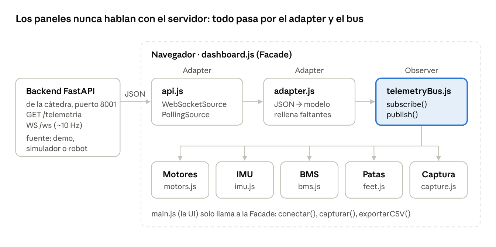

# TPO Robótica — Dashboard Web de Telemetría

26/10/2026

## Resumen

Construimos la versión web del monitor electroSim: un dashboard en el navegador que muestra en vivo la telemetría de un robot Unitree (Go2 o G1) servida por el backend FastAPI de la cátedra. El backend se usa tal cual; nuestro trabajo es el frontend en `mi_dashboard/`.

El mismo dashboard funciona contra tres fuentes sin cambiar una línea: el **modo demo** (`--demo`, datos generados), el **simulador** MuJoCo y el **robot real** en el laboratorio. Solo cambia la URL de la API.

## Arquitectura

Es una arquitectura cliente-servidor: el backend expone la telemetría por REST y WebSocket, y el navegador la consume y la dibuja. Dentro del frontend, cada dato pasa por tres capas antes de llegar a la pantalla.



El transporte trae el JSON, el adapter lo normaliza y el bus lo reparte a los cuatro paneles y a la captura. Los paneles no saben si el dato vino por WebSocket, por polling, del demo o del robot real.

## Patrones de integración

Los tres patrones que pide la consigna sirven para lo mismo: que la fuente de datos y la pantalla no se conozcan entre sí.

| Patrón | Dónde | Qué problema resuelve |
| --- | --- | --- |
| **Adapter** | `adapter.js`, `api.js` | Traduce el JSON del servidor a un modelo interno (con valores por defecto si falta algo) y unifica WebSocket y polling bajo la misma interfaz `start / stop`. Si cambia el formato o la fuente, solo se toca este archivo. |
| **Observer** | `telemetryBus.js` | Cada panel se suscribe al bus y la fuente publica. Agregar un panel nuevo es suscribirlo, sin tocar el transporte. Si un panel falla, los demás siguen. |
| **Facade** | `dashboard.js` | Un solo objeto con `conectar()`, `capturar()`, `alternarGrabacion()` y `exportarCSV()`. La UI (`main.js`) no sabe cómo llegan los datos ni cómo se dibujan. |

La grabación continua también es un suscriptor del bus: se activa suscribiéndose y se apaga desuscribiéndose.

## Requisitos de la consigna y cómo se cumplen

Están cubiertos todos los requisitos de la consigna, incluida la extensión con WebSocket.

| Requisito | Qué muestra el dashboard | Archivo |
| --- | --- | --- |
| Panel de motores | Tabla de 12 (Go2) o 29 (G1) motores con temperatura, ángulo (°), velocidad (rad/s) y torque (N·m). Semáforo: verde < 40 °C, amarillo 40–60 °C, rojo > 60 °C | `panels/motors.js` |
| Panel IMU | Roll, pitch y yaw numéricos + gráfico de línea con las últimas 120 muestras (la consigna pide 60). El yaw va en un eje propio porque recorre ±180° | `panels/imu.js` |
| Panel BMS | Carga (%) con barra, corriente (mA), temperatura (°C) y voltaje de cada celda | `panels/bms.js` |
| Panel de patas | FR, FL, RR y RL vistas desde arriba, verdes cuando están apoyadas | `panels/feet.js` |
| Actualización automática | WebSocket (~10 Hz) con reconexión, o polling a `/telemetria` cada 250 ms (máx. permitido: 500 ms) | `api.js` |
| Capturar muestra | Guarda el estado actual; extra: botón Grabar que captura todo de forma continua | `capture.js` |
| Exportar CSV | Descarga todas las muestras: una fila por muestra, una columna por dato (72 columnas en el Go2) | `capture.js` |

Arriba se ve siempre el estado de la conexión, el modo del servidor (demo o simulador), el robot y los mensajes por segundo que llegan.

## Decisiones técnicas

- **HTML + JavaScript sin framework, con Chart.js.** Es lo que nombra la consigna, no necesita Node ni build, y el día del laboratorio se abre en cualquier máquina. Además, los patrones quedan en código propio y se pueden mostrar, en vez de quedar escondidos dentro de un framework.
- **WebSocket primero, polling como respaldo.** El WebSocket recibe los datos en el momento, sin la demora fija del intervalo. Si se corta, reintenta esperando 0,5 s, 1 s, 2 s… hasta 8 s. En modo Auto, después de 3 fallos pasa a polling.
- **Polling sin superposición.** Cada pedido se programa cuando termina el anterior, así nunca hay dos en vuelo aunque el servidor tarde.
- **Rendimiento a 10 Hz.** La tabla de motores se arma una vez y después solo cambia el texto de cada celda. El gráfico corre sin animaciones y descarta la muestra más vieja.
- **Tolerancia a datos faltantes.** En modo simulador el BMS llega sin celdas, y el G1 no tiene las patas del Go2. Los paneles muestran «no reporta» en vez de romperse.
- **CSV.** Lleva BOM UTF-8 para que Excel lea bien los acentos y °. Si una muestra trae menos celdas o motores, esas columnas quedan vacías.

**Limitación conocida:** en demo, las temperaturas de los motores van de 34 a 43 °C, así que el rojo nunca aparece solo. Para mostrarlo se baja `TEMP_ROJO` en `config.js`.

## Cómo correrlo y demo para la defensa

Se levanta con dos terminales y se abre `http://localhost:5500`:

```bash
py -3 backend/arrancar_api.py --robot go2 --demo
py -3 -m http.server 5500 -d mi_dashboard
```

Para usar otra máquina o el robot real se cambia la URL en el campo **API**, o se abre la página con `?api=http://IP:8001`.

Guión sugerido de unos 5 minutos:

1. Mostrar `http://localhost:8001/telemetria` en el navegador: este es el contrato que consume el frontend.
2. Abrir el dashboard y recorrer los cuatro paneles. Señalar los mensajes por segundo (~10 Hz).
3. Cortar el backend con Ctrl+C: el estado pasa a «reconectando». Levantarlo de nuevo y se recupera solo.
4. Cambiar Transporte a Polling y mostrar en F12 → Network los pedidos cada 250 ms.
5. Grabar unos segundos, exportar el CSV y abrirlo.
6. Reiniciar con `--robot g1`: aparecen 29 motores sin tocar el código.
7. Cerrar con el código de `telemetryBus.js` y `dashboard.js` para mostrar Observer y Facade.

## Preguntas probables

**¿Qué cambia para usarlo con el robot real?** Nada en el frontend. Se cambia la URL de la API; el backend lee del robot por DDS y devuelve el mismo JSON.

**¿Por qué WebSocket y no solo polling?** Con polling hay una demora fija y un pedido HTTP completo cada 250 ms. Con WebSocket el servidor manda cada dato apenas lo tiene, por una sola conexión abierta. El polling queda como respaldo.

**¿Qué pasa si se cae la conexión?** El estado pasa a «reconectando» y reintenta con esperas cada vez más largas (hasta 8 s). Al volver el servidor, los datos siguen llegando sin recargar la página.

**¿Cómo agregarían un panel nuevo (por ejemplo, alarma de torque)?** Una clase con `init(info)` y `update(t)`, sumada a la lista de paneles en `main.js`. No se toca el transporte ni el resto de los paneles: es el Observer en acción.

**¿Por qué el rojo no aparece en la demo?** Porque el generador del demo nunca pasa de 43 °C. El umbral está en `config.js` y se puede bajar para mostrarlo.

**¿Los datos del simulador son reales?** Los ángulos, las velocidades y el yaw sí. El torque, la temperatura, el roll y el pitch, las patas y la batería se derivan del movimiento, según el `API.md` de la cátedra. Por eso los umbrales son configurables.
